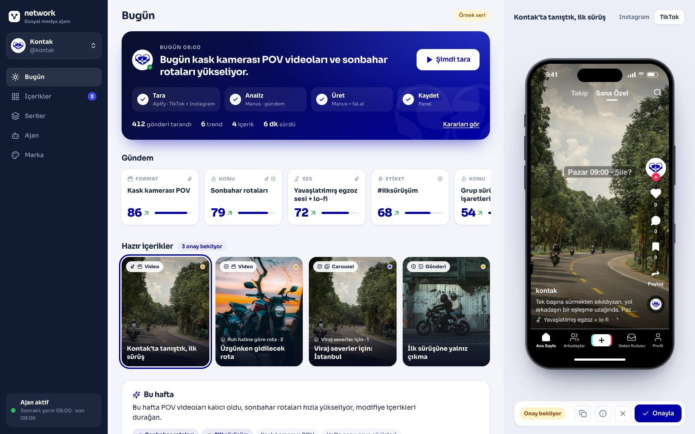
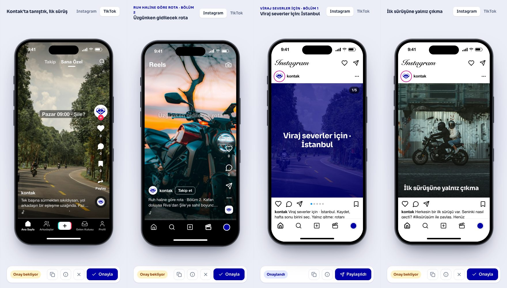
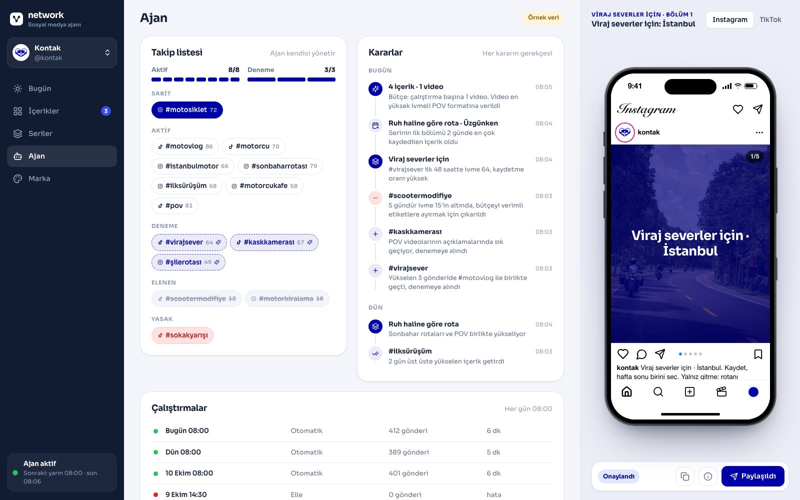
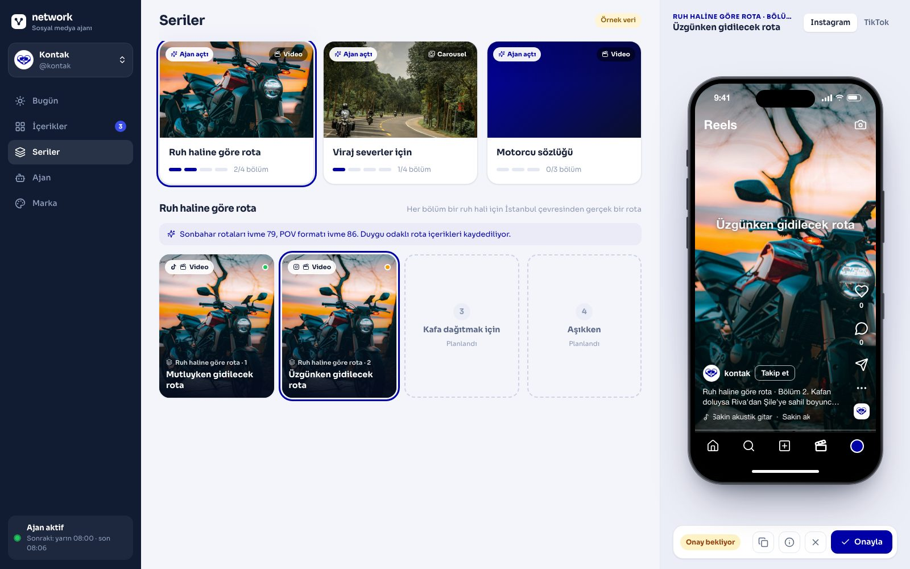

# Network: her gün kendi çalışan sosyal medya ajanı

**Istanbul Ignited by Slush'D Hackathon · Manus AI track · 12 Ekim 2026**

İlk marka: **kontak.social**, Türkiye'de motosiklet kültürü üzerine kurulu tanışma ve topluluk uygulaması.



## Problem

Küçük bir markanın sosyal medyası her gün aynı döngü: TikTok ve Instagram'da gezin, neyin yükseldiğini anlamaya çalış, fikir bul, metin yaz, görsel hazırla. Saatler gidiyor ve tutarlılık yok. Kontak ekibi de bunu elle yapıyordu.

## Çözüm

Her sabah kendi uyanan bir ajan:

1. **Tarar.** Apify ile TikTok ve Instagram'da markanın alanındaki son 48 saatin gönderilerini toplar.
2. **Analiz eder.** Manus, son 48 saati önceki 7 günle karşılaştırır. Popüler olanı değil, **yükseleni** bulur.
3. **Karar verir.** Hangi etiketleri izleyeceğini kendisi seçer: yeni etiketi denemeye alır, verimsizi eler (bütçe: 8 aktif + 3 deneme). Tek tek gönderi değil **seri** düşünür: "Ruh haline göre rota", "Viraj severler için". Her kararını gerekçesiyle kaydeder.
4. **Üretir.** Manus kanca, senaryo, sahne planı ve açıklamayı yazar. fal.ai görsel ve videoyu üretir.
5. **Onaya sunar.** Ekip paneldeki iPhone önizlemesinde içeriğin TikTok'ta ve Instagram'da tam olarak nasıl görüneceğini görür, tek tıkla onaylar.

**Önce:** her gün saatlerce elle araştırma. **Sonra:** ekip güne hazır, markaya uygun içerikle başlıyor.

## Ekranlar

| | |
|---|---|
|  |  |
| **Canlı önizleme:** TikTok, Reels, akış, carousel | **Ajan:** kendi yönettiği takip listesi ve gerekçeli kararlar |



## Mimari

```
Cloudflare Cron (her gün) ──► Cloudflare Workflow
                                 1. tara     Apify: TikTok + Instagram
                                 2. analiz   Manus: gündem + ivme, takip listesi kararları
                                 3. üret     Manus: seri, senaryo, sahneler · fal.ai: görsel + video
                                 4. kaydet   D1 (veri) + R2 (medya)
                                        │
                                        ▼
                         Panel (React) · iPhone önizleme · onay
```

- `backend/`: Cloudflare Worker, Workflow, D1, R2 (API sözleşmesi: [SOZLESME.md](SOZLESME.md))
- `frontend/`: React panel. Backend'e ulaşamadığı uçlarda örnek veriye düşer.
- `prompts/`: ajanın Manus'ta tasarlanıp test edilen promptları
- Tek tetik `POST /api/runs`, aynı akışı elle de başlatır ("Şimdi tara")

## Kurallar

- **Marka güvenliği:** yüzü görünen insan yok (kasklı ya da arkadan çekilmiş sürücü olabilir), güvensiz sürüş yok, başka marka logosu yok. Rotalar gerçek yerler, müzik gömülmez.
- **İnsan onayı:** ajan hazırlar, insan paylaşır.
- **Kişisel veri yok:** yalnızca herkese açık gönderi istatistikleri ve hesap adları.
- **Anahtarlar:** API anahtarları yalnızca Cloudflare secret olarak tutulur.

## Çalıştırma

```bash
cd frontend && npm install && npm run dev     # http://localhost:5173
cd backend && npx wrangler dev                # http://localhost:8787 (panel otomatik bağlanır)
```

## Ekip

- **Kemal:** panel ve entegrasyon
- **Burak:** backend, Cloudflare, Apify
- **Nida:** ajan beyni (Manus promptları), fal.ai, sunum
